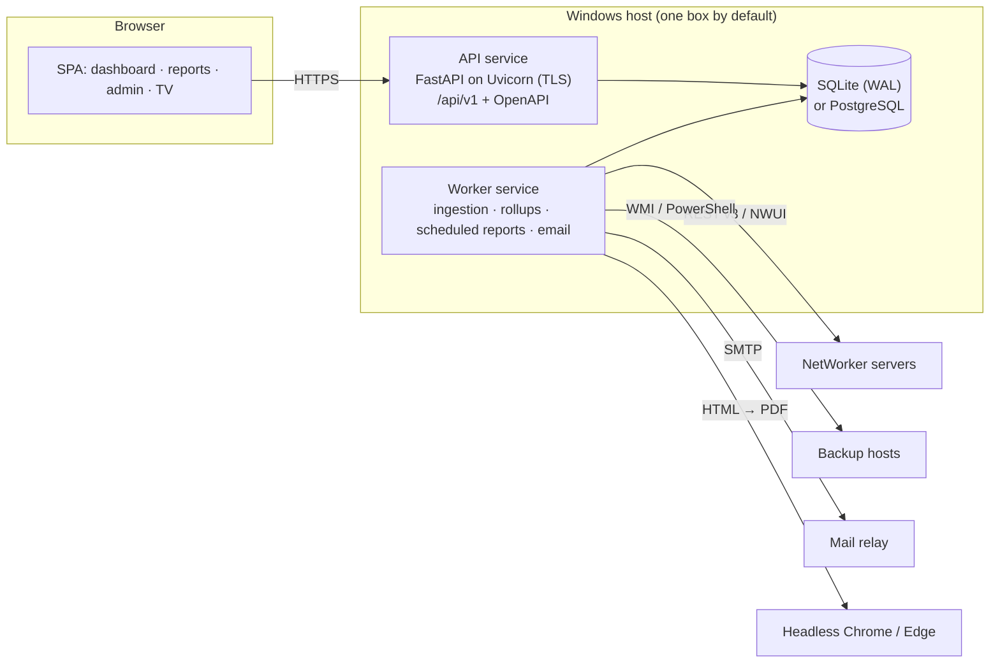

# Full-Stack Architecture: Options and Recommendation

**Date:** 2026-10-25
**Status:** Proposal (for decision)
**Related:** [Periodic backup & recovery reports](2026-10-25-periodic-reports-design.md) ·
[Code review 2026-10-25](../../REVIEW-2026-10-25.md)

## Short answer

Yes, it can be redesigned as a full-stack application, and the codebase is
already shaped for it: it has an HTTPS JSON API, a browser single-page UI,
background workers and file-based persistence, all running inside one Python
process. What makes a redesign hard is not technical capacity. It is the
deployment model this app was built for: air-gapped Windows hosts, an NSSM
service, an offline bundle of SHA-pinned artifacts, DPAPI-protected keys and a
small operations team. Any target stack has to keep those properties.

**Recommendation:** adopt a Python full stack (FastAPI + SQLite/PostgreSQL +
a built React or Vue SPA + a separate worker service). Reach it in phases rather
than as a rewrite, and ship the periodic-reports feature inside the current app
first, because it delivers most of the value on its own.

## The app today

| Layer | Today | Limit it hits |
|---|---|---|
| Web server | stdlib `ThreadingHTTPServer` + `ssl`, connection cap via semaphore (`nwdash/server.py`) | One thread per connection, and each SSE client holds a thread. No HTTP/2. Fine for tens of viewers, not hundreds. |
| API | Hand-routed `do_GET` / `do_POST`; several routes are RPC-style (`{"action": "..."}` in the body) | No versioning, no schema or OpenAPI, so validation is hand-written per route |
| Frontend | One ~3,000-line `app.js` + ~2,600-line `app.css`, inlined into a single HTML response (~1 MB, mostly a 208 KB logo inlined four times) | Not cacheable; the CSP needs `'unsafe-inline'`; hard to unit-test |
| Workers | Five daemon threads started in `nwdash/main.py` (server, shared refresh, session restore, auto-snapshot, automation scheduler) plus per-automation timers | No durable job state, retry queue or run history; a stuck NetWorker call ties up a thread |
| Persistence | About 12 JSON files under `data/`, written atomically (tmp + replace) | No history or query capability; each change rewrites the whole file; locking exists only inside the process |
| Auth | One shared password (PBKDF2), stateless HMAC cookie, CSRF tokens | No users, roles or audit trail; logout can't revoke a cookie (see the review) |
| Deployment | Embedded CPython 3.12.10 + NSSM + optional `cryptography` wheel, all SHA-pinned (`deploy/build-bundle.ps1`) | Strong supply-chain posture already; keep it |

## Requirements any redesign must keep

1. Installs and upgrades fully offline; no internet access at runtime; every
   artifact pinned by hash.
2. Runs as a Windows service; secrets protected at rest (DPAPI, or Windows
   Credential Manager).
3. One-box deployment by default. Splitting web, worker and database is optional.
4. The read-only share view and TV display mode survive.
5. Existing `data/` content migrates: connection profiles, email profiles,
   automations and snapshots.

## Options

**A. Evolve the stdlib monolith.** Keep zero third-party runtime dependencies.
Add a SQLite history store (`sqlite3` ships in the embedded runtime), a
versioned `/api/v1`, and ES-module front-end files served as cached static
assets.

**B. Python full stack.** FastAPI (Pydantic schemas, OpenAPI) on Uvicorn;
SQLAlchemy + Alembic over SQLite, with PostgreSQL as an option; a separate
worker service for ingestion, rollups and scheduled reports; a React + TypeScript
SPA built with Vite at bundle-build time and shipped as static files.

**C. Platform rewrite.** For example ASP.NET Core + EF Core + SQL Server +
Angular. This discards a working, tested Python codebase and its collector
knowledge; not justified here.

| Criterion | A. Evolve stdlib | B. Python full stack | C. Rewrite |
|---|---|---|---|
| Offline install complexity | Lowest (as today) | Medium: wheelhouse + built static assets in the bundle | High |
| Dependency / supply-chain surface | Minimal | ~30–60 pinned wheels + npm build-time packages | Large |
| Migration risk | Low | Medium, controlled by phasing | High |
| Multi-user auth / RBAC | Hand-built | Mature libraries | Mature |
| API contract (schema, docs, validation) | Hand-built | Built-in (OpenAPI) | Built-in |
| Scale (NetWorker servers, concurrent users) | Tens | Hundreds; async I/O for many collectors | Hundreds+ |
| Front-end testability | Hard (one file) | Component + end-to-end tests | Good |
| Effort | Weeks | Months (phased) | Many months |

## Recommended target (Option B)

- **API service.** Pydantic models act as schema, validation and documentation.
  Resource-style routes (`/api/v1/servers`, `/dashboards`, `/reports`,
  `/schedules`, `/exports`) replace the action-in-body routes. Uvicorn serves
  TLS directly; IIS or nginx in front is optional.
- **Auth.** Local users with roles (viewer / operator / admin), server-side
  session rows (revocable, idle timeout), an audit-log table, and optional
  Active Directory (LDAP) sign-in later. The current single-password mode
  becomes a one-time migration to an `admin` user.
- **Worker service.** Runs as a separate NSSM service, so a slow NetWorker API
  never blocks the web tier. A `job_runs` table records every ingestion and
  report run, which makes it observable and retryable. It reuses the
  existing collector, Excel and headless-browser code.
- **Database.** SQLite by default: no administration, WAL mode, backups via
  the online backup API. PostgreSQL only when web and worker move to separate
  hosts. Schema changes go through Alembic migrations.
- **Front end.** React + TypeScript + Vite, with charts from a vendored
  library and no CDN. A strict CSP with no `'unsafe-inline'`. Vitest for
  components and Playwright for end-to-end runs. Built once on the build host;
  the bundle ships static files only, so target hosts need no Node.js.
- **Packaging.** Extend `deploy/build-bundle.ps1`: resolve a lockfile
  (`pip-tools` or `uv`), run `pip download --only-binary=:all: --require-hashes`
  into a wheelhouse, `npm ci && vite build`, and emit an SBOM per release. Keep
  the existing SHA pins for CPython and NSSM.
- **Observability.** Keep the JSON log format. Add `/api/v1/health` and a
  Prometheus-format `/metrics` on both services.

## Migration plan

Every phase ships on its own, and the current app keeps running until each
capability has moved. The effort figures are rough planning estimates for one
experienced developer, not commitments.

| Phase | Scope | Exit criteria | Rough effort |
|---|---|---|---|
| 0. Harden | P0/P1 items from the 2026-10-25 review; pin ruff; add a Python 3.12 CI leg (the production runtime); serve JS/CSS/logo as cached static files; revocable sessions | CI green on 3.12 and 3.14; page weight under 300 KB; logout revokes | 1–2 weeks |
| 1. History + reports (current app) | Reports-design phases R1–R4: SQLite history store, ingestion worker thread, `/api/v1/reports`, exports, Reports UI for day/week/month/year, then scheduled period emails | Ingestion survives restarts; reports reconcile with NetWorker for a sample week; one month of period emails without a miss | 4–7 weeks + soak |
| 2. Extract the domain | Collectors, history store and report engine become modules with no HTTP coupling; tests run against recorded NetWorker responses | Collector tests run without a live server | 3–4 weeks |
| 3. New API alongside | FastAPI app hosts `/api/v1` using the phase-2 modules, on a second port; contract tests compare old and new responses | Parity suite green | 4–6 weeks |
| 4. New front end | Screens move one at a time: reports first (new), then dashboard, admin, TV; the old UI retires at parity | Playwright suite green; old UI removed | 6–10 weeks |
| 5. Users + cutover | RBAC, optional AD sign-in, migration tool for `data/*.json`, cutover and rollback runbook | Upgrade from the last stdlib release tested both ways | 1–2 weeks |

Phases 0–1 alone take about 1½–2½ months and deliver the reporting value.
The whole path is roughly 5–8 months of single-developer effort.

## Risks and how to contain them

- **Patching dependencies in an air-gapped estate.** Refresh the wheelhouse
  on a schedule (for example quarterly) and run `pip-audit` / `npm audit` on
  the connected build host before each bundle.
- **Collector parity.** The REST/NWUI collectors can only be fully proven
  against a live NetWorker server, which was already the top item deferred in
  `docs/PROJECT-STATE.md`. Record real responses (scrubbed) once, and use them
  as fixtures from then on.
- **Two code paths during migration.** Keep phases short, and retire each old
  surface as soon as its replacement reaches parity.
- **Scope creep.** Treat RBAC/AD and PostgreSQL as optional until someone
  needs them.

## When not to do it

If the dashboard serves a handful of administrators and the main gap is
long-range reporting, stop after phase 1. The full-stack move pays off when you
need several named users with roles, many NetWorker servers, multi-year history,
or more people contributing to the code.
