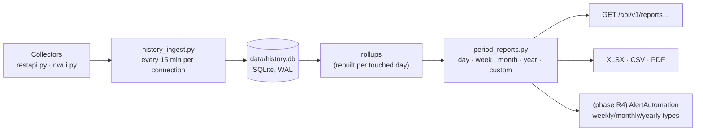

# Periodic Backup & Recovery Reports (Daily · Weekly · Monthly · Yearly)

**Date:** 2026-10-25
**Status:** Proposal (for decision)
**Related:** [Full-stack architecture](2026-10-25-full-stack-architecture-design.md) ·
[Code review 2026-10-25](../../REVIEW-2026-10-25.md) ·
[2.13.0 email revert](2026-07-21-email-revert-selfheal-design.md)

## Problem

Every report today is a view of **live** NetWorker data. That caps what can
be reported:

- **NetWorker's job database is short-lived by design.** Dell's guidance is to
  keep job-DB retention around 72 hours, and job records past retention are
  purged ([Dell community](https://www.dell.com/community/NetWorker/NMC-vs-jobsdb-retention/td-p/7071934),
  [KB 000168599](https://dell.com/support/kbdoc/en-us/000168599/networker-a-deleted-or-decommissioned-policy-does-not-disappear-from-the-monitoring-tab-on-networker-management-console-nmc)).
  "Last Week" and "Last Month" therefore silently cover only what the server
  still keeps, and nothing in the code detects or reports the shortfall
  (`nwdash/restapi.py:1174-1177`).
- **Snapshots can't fill the gap.** They hold one aggregate row per day, mixed
  across ranges, capped at 180 days and never checked for staleness
  (`nwdash/snapshots.py:83-133`).
- **No per-job history exists anywhere locally**, so no report can be
  computed for a calendar month or year, and none can be compared with the
  previous period.
- **The collectors have counting bugs** that a period report would amplify:
  jobs collapsed by same-second dedup, recoveries counted twice, sorting by a
  `dd-mm-YYYY` string, failures of long-running jobs never attributed to any
  day. See review items C1–C8.

## Lessons from 2.9–2.12

Four successive redesigns replaced the working email engine and each one
introduced new failure modes, until 2.13.0 reverted to the v2.8.3 engine
(`4096fe6`). This design is therefore **additive**:

1. The history store and report engine are new modules. They read from the
   collectors and are independent of the email engine and the existing UI.
2. Everything sits behind a switch (`--enable-history`, off by default).
   Turning it off loses nothing and changes no existing behaviour.
3. It uses no new connection or credential model. Ingestion reuses the existing
   sessions and the self-healing connection snapshot.
4. Scheduled period emails come **last**, as one new schedule type on the
   existing `AlertAutomation` engine, and only after the ledger has been
   reconciled against live NetWorker data.

## Goals and non-goals

**Goals:**
- Calendar day, week, month and year reports, plus custom ranges.
- Comparison with the previous period, and year-on-year comparison.
- Breakdowns by client, policy and workflow.
- Failure analysis, including chronic failures.
- Clients with no successful backup in the period.
- Recoveries, data volume trends and clone compliance.
- A visible data-coverage figure on every report.
- XLSX, CSV and PDF exports.
- On-demand reports in the UI, then scheduled emails.

**Non-goals:**
- Replacing NMC reporting or Data Protection Advisor.
- Storage-array capacity planning.
- Multi-tenancy.

## Architecture (inside the current app)



New flat modules, following the package's existing layout:

| Module | Job |
|---|---|
| `history_store.py` | Schema, migrations (`schema_version`), connections, retention and vacuum |
| `history_ingest.py` | Fetch, normalise, upsert, rollup rebuild, coverage, `ingest_run` audit |
| `job_status.py` | **One** status classifier shared by REST, NWUI and the ledger (fixes C5) |
| `periods.py` | Pure period maths: day, ISO or configurable week, month, year or fiscal year, previous period, half-open windows |
| `period_reports.py` | Builds the report dict from rollups and raw jobs |
| `period_exports.py` | XLSX, CSV and PDF built from the report dict |

`sqlite3` ships in the production runtime. The embedded CPython 3.12.10 has
SQLite 3.49.1, which supports window functions, `strftime('%G-W%V')` and
upserts (verified 2026-10-25).

## What to collect

| Source | Fields | Cadence | Purpose |
|---|---|---|---|
| `GET /global/jobs`, windowed (see below) | `id`, `parentJobId`, `type`, `state`, `completionStatus`, `startTime`, `endTime`, `clientHostname`, `name`, `policyName`, `workflowName`, `policyActionName`, `level`, plus a size field | every 15 min | The job ledger |
| `GET /global/jobs?q=completionStatus:"Failed"` (adds `message`) | `id`, `message` | every 15 min | Failure text, joined by `id` (today it is missing in NWUI mode, C9) |
| `GET /global/backups?q=saveTime:[… TO …]` | save-set id, client, name, level, `saveTime`, size, retention, clone instances | daily, previous day plus catch-up | Data volume, clone compliance, and backfill of successful history past job-DB retention |
| `GET /global/clients` | hostname, enabled, protection groups | daily | Expected-client inventory for "unprotected clients" |
| NWUI `monitoringrecoveries` / recover jobs | client, type, status, start, end, size | every 15 min | Recoveries section |

**Field names are candidates.** Validate them against the target NetWorker
version first. `nwui_rest_fallback_items()` already strips any field a server
rejects with HTTP 400, so a wrong name degrades gracefully.

**Server-side windowing is a big potential win.** `restapi.py:273-278` says
NQL has no range operators. That is true of `startTime>=…`, which is what the
code tried. Dell's KB documents a bracketed range form on the same endpoint:
`/nwrestapi/v3/global/jobs?q=endTime:["YYYY-MM-DDTHH:mm:SS" TO "YYYY-MM-DDTHH:mm:SS"]`
([KB 000172472](https://www.dell.com/support/kbdoc/en-us/000172472/networker-rest-api-http-get-requests-are-intermittently-timing-out)).
If the target version accepts it, ingestion fetches only the last window,
filtered by completion time, instead of the whole job DB (36,031 jobs /
11.5 MB observed, per the code comment). The same applies to the dashboard.
Keep the whole-DB fetch as the fallback when the server rejects the query.

## Storage

Times are stored as UTC epoch seconds. Day buckets use the host's local time
(SQLite `'localtime'`), which matches the rest of the app. The embedded
runtime has no IANA timezone data (`zoneinfo` raises
`ZoneInfoNotFoundError`, verified), so per-report timezones would need the
`tzdata` wheel added to the bundle. Every window is half-open: `[start, end)`.

```sql
CREATE TABLE job (                         -- one row per NetWorker job
  server_id INTEGER NOT NULL, nw_job_id INTEGER NOT NULL, start_ts INTEGER NOT NULL,
  kind   TEXT NOT NULL CHECK (kind IN ('backup','clone','recover','other')),
  status TEXT NOT NULL CHECK (status IN ('succeeded','failed','warning','cancelled','running','unknown')),
  client TEXT NOT NULL DEFAULT '', policy TEXT NOT NULL DEFAULT '', workflow TEXT NOT NULL DEFAULT '',
  level  TEXT NOT NULL DEFAULT '', end_ts INTEGER, size_bytes INTEGER, error TEXT,
  last_seen_ts INTEGER NOT NULL,
  PRIMARY KEY (server_id, nw_job_id, start_ts)
) WITHOUT ROWID;
CREATE INDEX job_by_end ON job (server_id, end_ts);

CREATE TABLE daily_rollup (                -- rebuilt for every day an ingest touches
  day TEXT NOT NULL, server_id INTEGER NOT NULL, client TEXT NOT NULL, policy TEXT NOT NULL,
  kind TEXT NOT NULL, jobs INTEGER NOT NULL, succeeded INTEGER NOT NULL, failed INTEGER NOT NULL,
  warning INTEGER NOT NULL, bytes INTEGER NOT NULL, busy_s INTEGER NOT NULL,
  PRIMARY KEY (day, server_id, client, policy, kind)
) WITHOUT ROWID;
-- also: server, client_inventory, saveset, ingest_run, coverage, report_run, schema_version
```

Other decisions:
- **Primary key.** The job id plus `start_ts`, not a (workflow, action,
  start-second) key. This removes the collapse bug (C1).
- **Late updates.** A job seen as `running` and later as `failed` is
  upserted, and its day's rollup is rebuilt from the raw rows rather than
  incremented.
- **Retention.** Raw `job` rows are kept 400 days by default (configurable).
  Rollups are kept indefinitely, at roughly 1,000 rows per day for 500
  clients. `ingest_run` is kept 90 days. An incremental vacuum runs monthly.
- **Concurrency.** The ingest thread is the only writer. HTTP handlers open
  read connections, which WAL mode allows to run concurrently with the writer.

### Prototype results (measured 2026-10-25, production runtime)

Embedded CPython 3.12.10 / SQLite 3.49.1, synthetic data: 500 clients ×
4 jobs/day × 400 days = 800,000 jobs.

| Measure | Result |
|---|---|
| Database size | 111 MiB |
| Bulk upsert | ~223,000 rows/s (800k in 3.6 s) |
| Full rollup rebuild (400 days) | 1.2 s → 391,562 rollup rows |
| One 15-min cycle (re-upsert 2 days, rebuild 3 days) | 43 ms |
| Day report | 0.2 ms |
| Week / month / year report (date-range on rollup primary key) | 1.2 / 4.6 / 39.5 ms |
| Clients with no successful backup in a month | 50 ms |
| Chronic failures (≥3 consecutive, window function over raw jobs) | 104 ms |

Querying periods by a formatted key (`strftime('%Y-%m', day) = ?`) scans
the whole table: month 56 ms, year 116 ms. Always query by date range.

## Ingestion

- **Thread.** A daemon thread, `history-ingest`, runs one cycle per
  connection every 15 minutes. It reuses the connection's session or its
  self-healing snapshot.
- **Cycle:**
  1. Fetch, windowed when supported, from `last_success_end - 1h` to now.
  2. Classify with `job_status.py`.
  3. Upsert.
  4. Rebuild the rollups for touched days.
  5. Write an `ingest_run` row: window, rows seen and new, the oldest job
     timestamp in the response, and whether it was truncated.
  6. Update coverage.
- **Coverage.** A period is covered for a server when successful runs'
  `[oldest job seen, fetch time]` intervals span it. Every report states its
  coverage, for example: "covers 96%: no data 2026-09-14 02:00–09:00 (service
  stopped)". A gap older than the server's job-DB retention is permanent, and
  the report says so instead of showing zero.
- **Backfill on first enable.** Load whatever the job DB still holds, plus
  save sets (which outlive the job DB) for older *successful* backup volume.
  Mark the save-set-derived days "successes only: failures unknown".
- **Safety.**
  - Ingestion never runs inside an HTTP request.
  - Its failures are logged and recorded in `ingest_run`.
  - Fetches are single-flight with the dashboard's own job fetch, so they never
    double the load on NetWorker (C11).

## Periods

| Grain | Window (local time, half-open) | Compared with |
|---|---|---|
| Day | `[D 00:00, D+1 00:00)` | previous day; same weekday last week |
| Week | ISO Monday–Sunday by default; start day configurable (Sunday or Saturday are common in some regions) | previous week |
| Month | calendar month | previous month; same month last year |
| Year | calendar year, or a fiscal year with a configurable start month | previous year |
| Custom | `[from, to)` up to 400 days (raw) or unlimited (rollups) | the preceding period of equal length |

**Attribution.** A job belongs to the period in which it **ended**. Jobs still
running at the period's end are listed separately. This fixes C7: today a
backup that starts at 07:00 and fails at 11:00 appears in no daily report.

**Closed periods are immutable.** Once a closed period's coverage is complete,
its rendered report is cached in `report_run`. Re-opening it or emailing it
later returns exactly what was reviewed.

## Report content

Metric definitions are printed in every report's footer.

| # | Section | Contents |
|---|---|---|
| 1 | Summary | Jobs; succeeded; failed; warnings. **Success rate = succeeded ÷ (succeeded + failed)**; whether warnings count is a setting. Data protected (bytes). Clients protected ÷ expected clients. Recoveries (count, success rate). Clone compliance. Coverage %. |
| 2 | Trend | Each KPI against the previous period (Δ and direction). Daily sparkline for week and month reports; monthly bars for year reports. |
| 3 | Failures | All failures (day report) or top-N (other grains). Chronic failures (≥3 consecutive). Failures by policy and workflow. Top error messages, grouped by normalised text. |
| 4 | Unprotected clients | Enabled inventory clients with no successful backup in the period, with their last successful backup date. |
| 5 | By policy / workflow | Jobs, success rate, bytes, busy time. |
| 6 | By client | The same columns. Paginated in the UI; complete in exports. |
| 7 | Recoveries | Count, success rate, duration, data restored, by client. |
| 8 | Volume and growth | Bytes per day or month; top growth clients (month and year grains). |
| 9 | Clone compliance | Save sets with and without a clone copy within N hours of the backup. |
| 10 | Data quality | Coverage, ingestion gaps, truncation flags, the collector mode used, and the definitions. |

Detail scales with the grain:
- **Day:** job-level detail.
- **Week:** a per-day breakdown.
- **Month:** per week and per client.
- **Year:** per month, year-on-year, and top lists only.

## Delivery

- **API** (authenticated, read-only GETs):
  - `GET /api/v1/reports?grain=month&period=2026-09&server=…&compare=previous`
  - `GET /api/v1/reports/export?…&format=xlsx|csv|pdf`
  - `GET /api/v1/history/coverage`
- **UI.** A Reports view with a grain selector (Day / Week / Month / Year /
  Custom), a period picker, server and policy filters, a compare toggle and a
  coverage banner. You can drill down from a client to its jobs. It's a new
  view and leaves the existing dashboard unchanged.
- **Exports:**
  - **XLSX.** Reuses the existing writer, with real number and date cells and
    no 80-row cap. Sheets: Summary, Trend, By client, By policy, Failures,
    Unprotected, Recoveries, Coverage. XML-illegal characters are stripped
    (C14).
  - **CSV.** Guarded against formula injection (C15).
  - **PDF.** Rendered from the same HTML by the headless Edge or Chrome the app
    already uses for PNG snapshots (`--print-to-pdf`).
- **Scheduled emails (phase R4):**
  - Add `weekly_report`, `monthly_report` and `yearly_report` to the existing
    engine, built from the **ledger**, not live data.
  - Send after the period closes and its coverage is confirmed, for example at
    06:00 on the 1st.
  - Dedup on (type, period key), never on content (fixes C3).
  - Persist `next_run_at` and `last_run`, catch up after a restart, and retry
    with backoff (fixes C6).

## Prerequisites from the review

Fix these first, because the ledger would otherwise store their errors
permanently:

| Item | Fix |
|---|---|
| C1 | Dedup history by job id |
| C2 | Sort by the numeric start timestamp |
| C4 | Count recoveries separately from backups |
| C5 | One status classifier for REST and NWUI; fetch `state` |
| C7 | Attribute jobs by end time |
| C8 | Flag pagination truncation |
| C10 | A failed history fetch blocks or flags the report instead of showing zero |

## Testing and validation

- **Unit tests:**
  - `periods.py`: DST change days, ISO week 53 and week-year boundaries, leap
    years, fiscal years.
  - A table test for `job_status.py` covering every raw status seen.
  - Rollup and coverage arithmetic.
- **Golden tests.** Scrubbed, recorded NetWorker responses are ingested, and
  the resulting report JSON is compared with checked-in expected output.
  These run in CI with no live server.
- **Load test.** A CI test with 100k synthetic jobs asserts the cycle and
  query budgets above.
- **Live validation gate.** Run ingestion for 7 days with the feature hidden
  from users. Reconcile three sample days' totals against NMC. Only then
  enable the Reports view, and enable scheduled emails a week after that.

## Phases

The effort figures are rough estimates for one developer.

| Phase | Scope | Ships when | Effort |
|---|---|---|---|
| R0 | Collector fixes C1, C2, C4, C5, C7, C8, C10 | Tests green; one live-server check | 1–2 weeks |
| R1 | `history_store` + `history_ingest` + `job_status`, behind `--enable-history`; coverage | 7-day soak with no gaps; reconciled totals | 1–2 weeks |
| R2 | `periods` + `period_reports` + `/api/v1/reports` + exports | Golden tests green | 1–2 weeks |
| R3 | Reports view in the UI | Reviewed with the operator | 1–2 weeks |
| R4 | Weekly, monthly and yearly scheduled emails on the existing engine | One full month delivered without a miss | 1 week + 1 month soak |

## Open questions for the operator

1. What job-DB retention ("jobsdb retention in hours") is set on each
   NetWorker server? It determines how long the dashboard can be offline
   before a gap becomes permanent.
2. Which day starts the week, and does a fiscal year apply?
3. Do warnings count as success in the success rate?
4. "Expected clients": every enabled NetWorker client, or a curated list?
5. How long to keep raw job history? 400 days is proposed; rollups are kept
   indefinitely.
6. Which audiences get the weekly, monthly and yearly emails?
